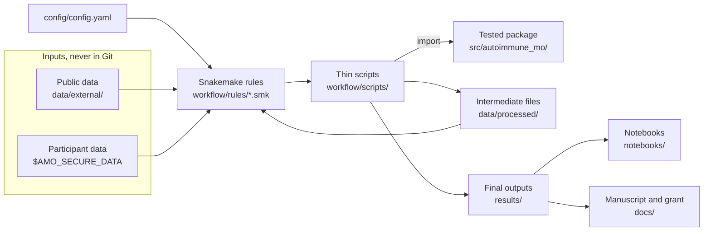

# Architecture

This repository is organized so that every result can be regenerated from three things:
**code** (`src/`, `workflow/`), **configuration** (`config/`) and **input data** that live outside Git.

## Data flow



## Layers and their rules

| Layer | Location | Responsibility | Rule |
| --- | --- | --- | --- |
| Configuration | `config/config.yaml` | Every parameter, path and threshold | No numbers or paths hard-coded in code |
| Pipeline | `workflow/rules/<analysis>.smk` | What runs, in what order, with which inputs and outputs | One rule file per analysis |
| Scripts | `workflow/scripts/` | Glue between Snakemake and the package | Under ~50 lines; no analysis logic |
| Package | `src/autoimmune_mo/<analysis>/` | All analysis logic, as functions | Every public function has a test |
| Environments | `environment.yml`, `workflow/envs/` | Software versions | R tools get their own env file |
| Outputs | `data/processed/`, `results/` | Generated files | Never edited by hand; delete and rerun |
| Notebooks | `notebooks/` | Exploration and figure drafting | Read from `results/` only; never the source of a result |
| Docs | `docs/` | Methods, manuscript, (private) grant | Methods written alongside the code |

## Analyses

Each analysis has the same pieces, with matching names:

| Analysis | Rule file | Package module | Results folder | Data |
| --- | --- | --- | --- | --- |
| Synthetic demo | `demo.smk` | all modules | `results/demo/` | Generated, no real data |
| Mendelian randomization | `mr.smk` | `autoimmune_mo.mr` | `results/mr/` | Public GWAS summary statistics |
| Single-cell RNA-seq | `scrnaseq.smk` | `autoimmune_mo.scrnaseq` | `results/scrnaseq/` | Public PBMC scRNA-seq, then Phase 2 |
| Fatty-acid classifier | `classifier.smk` | `autoimmune_mo.ml`, `autoimmune_mo.metabolomics` | `results/classifier/` | Secure (participant-level) |
| Bulk RNA-seq | `rnaseq.smk` | `autoimmune_mo.rnaseq` | `results/rnaseq/` | Phase 2 FASTQ |
| Microbiome | `microbiome.smk` | `autoimmune_mo.microbiome` | `results/microbiome/` | Phase 2 FASTQ |
| Integration | added with Phase 2 data | `autoimmune_mo.integration` | `results/integration/` | Secure |
| Networks | inside each analysis | `autoimmune_mo.network` | per analysis | Any feature matrix |

Every input table is validated against `autoimmune_mo.standards` before analysis
(see the data standards page of the documentation).

## Conventions

- **Rule names:** `<analysis>_<step>` (e.g. `mr_harmonise`), plus one `<analysis>_all` target per analysis.
- **File names:** lowercase, underscores, wildcards last: `results/mr/estimates_{exposure}.tsv`.
- **Tables:** tab-separated `.tsv` with a header row; one row per observation.
- **Randomness:** every stochastic step reads `random_seed` from the config.
- **Logs:** every rule writes to `logs/<analysis>/` (ignored by Git).
- **Secure data:** referenced only through the `AMO_SECURE_DATA` environment variable, set on the
  machine that holds the data. Code and config never contain the real path.

## Adding a new analysis

1. Add a section to `config/config.yaml`.
2. Create `workflow/rules/<analysis>.smk` with an `<analysis>_all` rule, and `include:` it in `workflow/Snakefile`.
3. Put logic in `src/autoimmune_mo/<analysis>/` and tests in `tests/test_<analysis>*.py`.
4. Keep scripts in `workflow/scripts/` thin: read inputs, call the package, write outputs.
5. Write `docs/methods/<analysis>.md` and update the status table in `README.md`.

## Running

Snakemake reads its default settings from `workflow/profiles/default/config.yaml`
(4 cores, per-rule conda environments, rerun when code, parameters or software change).

```bash
snakemake -n mr_all                     # dry run: show what would run
snakemake mr_all                        # run with the default profile
snakemake --cores 8 mr_all              # override a profile setting
export AMO_SECURE_DATA=/secure/path     # only on the machine with participant data
snakemake classifier_all
```

The `demo_all` target runs the pipeline on synthetic data and needs no data access. CI runs it on
every push and checks that a second run produces identical output.
