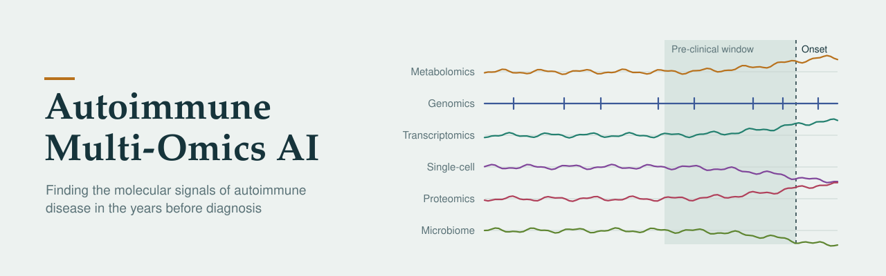

<p align="center">
  
</p>

<p align="center">
  <a href="https://github.com/mtariqi/autoimmune-multiomics-ai/actions/workflows/ci.yml"></a>
  <a href="https://www.repostatus.org/#wip"></a>
  <a href="LICENSE"></a>
  <a href="https://mtariqi.github.io/autoimmune-multiomics-ai/"></a>
  <a href="CITATION.cff"></a>
  <a href="https://github.com/mtariqi/autoimmune-multiomics-ai/commits/main"></a>
  <br>
  
  
  <a href="https://snakemake.github.io"></a>
  <a href="https://scanpy.readthedocs.io"></a>
  <a href="https://github.com/astral-sh/ruff"></a>
</p>

A systems biology framework that integrates six layers of molecular data to identify biomarkers
and predict autoimmune disease risk using explainable artificial intelligence. The first
application is the pre-clinical phase of rheumatoid arthritis (RA).

**Research question:** Do serum fatty-acid disturbances precede and contribute to RA, and can
integrated multi-omics predict who among at-risk individuals will progress?

## Objectives

1. **Early disease prediction:** a validated risk score for people at elevated risk, before symptoms.
2. **Disease subtype discovery:** reproducible molecular endotypes with different progression rates.
3. **Biomarker identification:** features that change before onset, tested for causality.
4. **Precision medicine development:** evidence to select who should enter prevention trials.

## Data layers

| Layer | What is measured | Phase |
| --- | --- | --- |
| Metabolomics | Serum fatty acids and oxylipins (LC-MS/MS) | 1 (existing data), 2 |
| Genomics | Genotypes, polygenic scores, Mendelian randomization instruments | 1 (public GWAS), 2 |
| Transcriptomics | Whole-blood and PBMC gene expression | 2 |
| Single-cell RNA-seq | PBMC immune cell states | 1 (public data), 2 |
| Proteomics | Inflammatory proteins (Olink) | 2 |
| Microbiome | Shotgun stool metagenomics | 2 |

**Phase 1** is preliminary work on public and existing data, in progress now.
**Phase 2** is the prospective at-risk cohort described in the grant proposal.

## Technologies

| Tool | Used for |
| --- | --- |
| Python 3.11 | Analysis package (`src/autoimmune_mo`), machine learning |
| R 4.3 | Mendelian randomization (TwoSampleMR) |
| Snakemake | Reproducible pipeline, per-rule conda environments |
| Scanpy | Single-cell RNA-seq analysis |
| scikit-learn, XGBoost, LightGBM | Leakage-safe nested cross-validation, prediction models |
| SHAP | Explaining model predictions |
| lifelines | Survival models for time to onset |
| networkx | Correlation networks, hubs and modules |
| CellTypist, MOFA+ | Cell-type annotation, multi-omics factor analysis |
| STAR, featureCounts, DESeq2 | Bulk RNA-seq (Phase 2) |
| MetaPhlAn, HUMAnN | Shotgun metagenomics (Phase 2) |
| conda, GitHub Actions | Pinned environments, automated tests and pipeline runs |
| MkDocs Material | Documentation website |

## Status

| Component | State |
| --- | --- |
| Data standards, metabolomics, microbiome, single-cell, integration, ML, explainable AI and network modules | Implemented and tested; run end to end on synthetic data (`snakemake demo_all`) |
| Bulk RNA-seq and shotgun metagenomics workflows | Written; waiting for Phase 2 sequencing data |
| Mendelian randomization | Planned next |
| Preliminary results on real data | Not started |

See [ROADMAP.md](ROADMAP.md) for the 12 to 18 month plan and the [documentation website](https://mtariqi.github.io/autoimmune-multiomics-ai/) for methods.

## Repository layout

```
config/             all parameters and paths (config.yaml)
data/               NOT version-controlled except README and metadata templates
docs/               documentation website source, methods, manuscript (not published)
notebooks/          exploration only (see notebooks/README.md)
results/            generated figures, tables, models
src/autoimmune_mo/  tested Python package
  standards.py        table schemas and validation
  metabolomics/       QC, imputation, fatty-acid indices, differential analysis
  rnaseq/             count filtering, log-CPM
  scrnaseq/           Scanpy preprocessing, pseudobulk, program scores
  microbiome/         CLR, diversity, Aitchison distance
  integration/        block scaling, per-layer PCs, MOFA+
  ml/                 grouped splits, model registry, nested CV, SHAP and stability
  network/            correlation networks, hubs, modules
workflow/           Snakemake pipeline: rules/, scripts/, envs/, profiles/
tests/              unit tests (pytest)
```

See [ARCHITECTURE.md](ARCHITECTURE.md) for the data flow, layer rules and naming conventions.

## Quick start

```bash
conda env create -f environment.yml
conda activate autoimmune-mo
pip install -e .
pytest
snakemake all            # runs the synthetic demo end to end
mkdocs serve             # documentation website at http://127.0.0.1:8000
```

## Reproducing results

All results are produced by the Snakemake pipeline in `workflow/`. Settings (cores, conda
environments, rerun triggers) come from `workflow/profiles/default/config.yaml`.

| Target | What it runs | Data needed |
| --- | --- | --- |
| `snakemake all` | Environment check + synthetic demo of every module | None |
| `snakemake mr_all` | Mendelian randomization | Public GWAS in `data/external/gwas/` |
| `snakemake scrnaseq_all` | Single-cell re-analysis | Public `.h5ad` files in `data/external/scrnaseq/` |
| `snakemake classifier_all` | Fatty-acid classifier | `AMO_SECURE_DATA` set (secure machine only) |
| `snakemake rnaseq_all` | FastQC, Trim Galore, STAR, featureCounts, DESeq2, MultiQC | FASTQ in `data/raw/rnaseq/` (Phase 2) |
| `snakemake microbiome_all` | MetaPhlAn, HUMAnN, diversity | FASTQ in `data/raw/microbiome/` (Phase 2) |

Useful commands:

```bash
snakemake -n mr_all                                   # dry run: list jobs without running
snakemake --dag mr_all | dot -Tsvg > results/figures/dag_mr.svg   # pipeline diagram
snakemake --report results/report.html                # HTML report with provenance
snakemake --summary                                   # status and code version of every output
```

**Software versions.** `environment.yml` pins major versions. After creating the environment,
record the exact versions and commit the file:

```bash
conda env export --no-builds -n autoimmune-mo > environment.lock.yml
```

To rebuild the exact environment later: `conda env create -f environment.lock.yml`.

**Determinism.** Every stochastic step reads `random_seed` from `config/config.yaml`. CI runs the
demo twice from scratch and fails if the outputs differ.

## Data policy

No individual-level participant data are ever committed. `data/raw/` is read-only input;
everything in `data/processed/` and `results/` must be reproducible from code.
See `data/README.md`.

## Citation

See `CITATION.cff`.

## License

Code: MIT. Documentation and figures: CC BY 4.0 unless stated otherwise.
