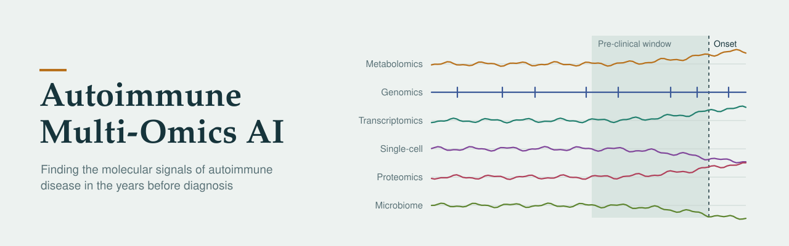

# Autoimmune Multi-Omics AI

A systems biology framework that integrates metabolomics, genomics, transcriptomics, single-cell
RNA-seq, proteomics and microbiome data to identify biomarkers and predict autoimmune disease
risk with explainable machine learning. The first application is the pre-clinical phase of
rheumatoid arthritis (RA).

**Research question:** do serum fatty-acid disturbances precede and contribute to RA, and can
integrated multi-omics predict who among at-risk individuals will progress?

## Where to start

| If you want to | Read |
| --- | --- |
| See how the code is organized | [Architecture](architecture.md) |
| Prepare data for the pipeline | [Data standards](data-standards.md) |
| Rerun an analysis | [Reproducibility](reproducibility.md) |
| Understand a method | Methods pages, one per data layer |
| See what is done and what is next | [Roadmap](roadmap.md) |

Source code: [github.com/mtariqi/autoimmune-multiomics-ai](https://github.com/mtariqi/autoimmune-multiomics-ai)
